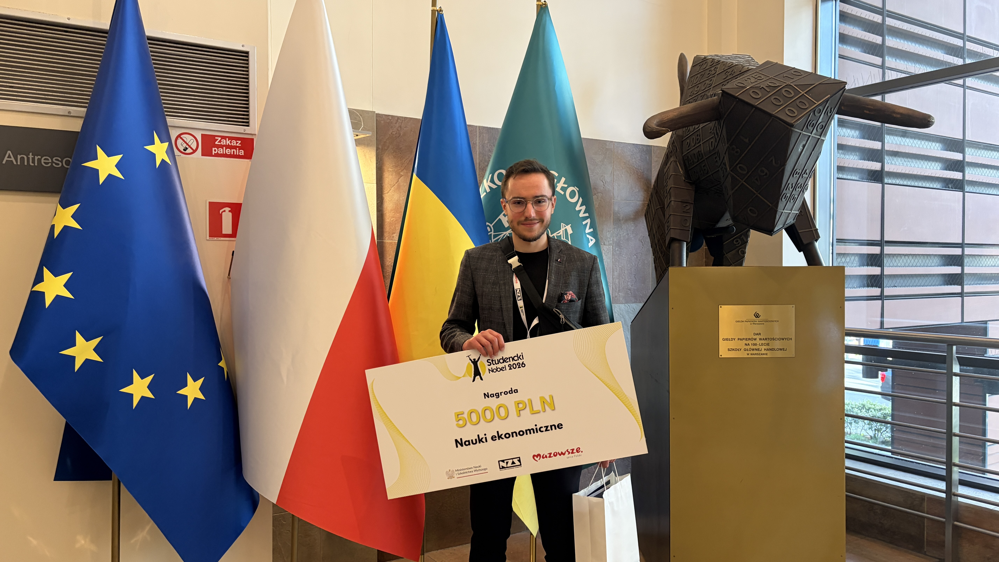
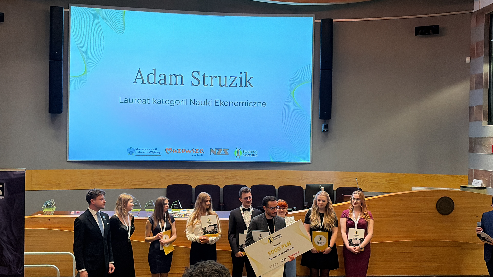
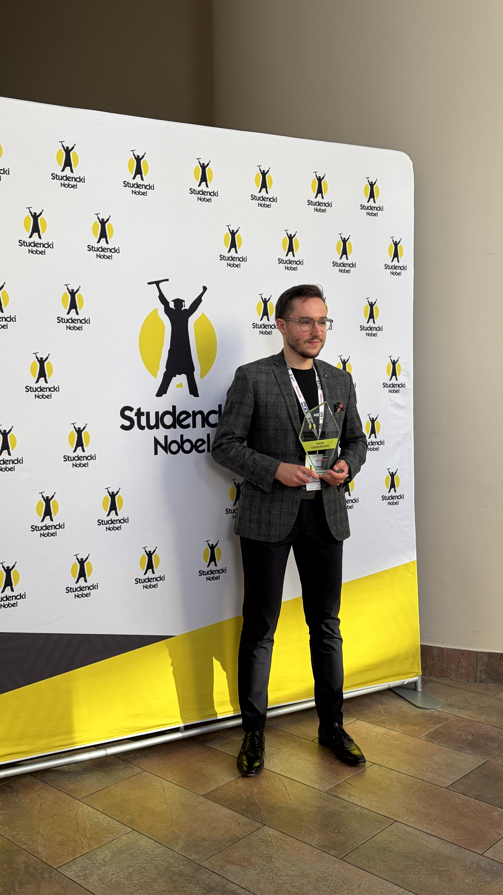

::: {.panel-tabset}

## Polski

Adam Struzik został laureatem konkursu „Studencki Nobel”. Konkurs ma na celu wyłonienie najlepszych studentów w Polsce w kilku kategoriach. Adam Struzik został wybrany najlepszym studentem w kategorii Nauki Ekonomiczne.

Gala finałowa odbyła się 23 maja 2026 r. w Szkole Głównej Handlowej w Warszawie.

## English

Adam Struzik won the Polish 'Student Nobel Prize' competition. The competition aims to award the best students in Poland in several categories. Adam Struzik was selected as the best student in the Economic Sciences category.

The final gala took place on 23 May 2026 at the Warsaw School of Economics.

:::

{width="60%" fig-align="center"}

{width="60%" fig-align="center"}

{width="60%" fig-align="center"}
