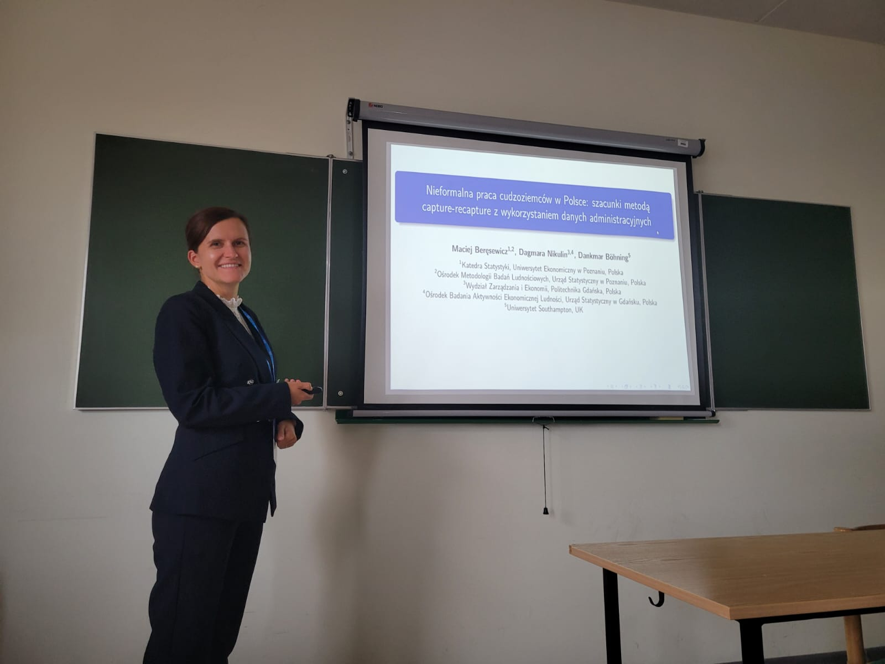

::: {.panel-tabset}

## Polski

Wyniki badań prowadzonych w ramach projektu finansowanego przez Narodowe Centrum Nauki (OPUS 20, nr 2020/39/B/HS4/00941) zaprezentowano 25 września podczas XV Konferencji Komitetu Badań nad Migracjami PAN na Wydziale Nauk Społecznych Uniwersytetu Gdańskiego. Konferencja zorganizowana została przez Komitet Badań nad Migracjami PAN, Centrum Zrównoważonego Rozwoju i Instytut Politologii Uniwersytetu Gdańskiego, Muzeum Emigracji w Gdyni oraz Urząd Marszałkowski Województwa Pomorskiego. W sesji „Metodologiczne wyzwania i rozwiązania w badaniach migracji” przedstawiono badanie Macieja Beręsewicza, Dagmary Nikulin i Dankmara Böhninga, w którym wykorzystano dane administracyjne oraz metodę capture–recapture w celu oszacowania rozmiarów pracy nielegalnej wykonywanej przez cudzoziemców w Polsce.

## English

Findings from a research project funded by the National Science Centre, Poland (OPUS 20, grant no. 2020/39/B/HS4/00941), were presented on 25 September at the 15th Conference of the Polish Academy of Sciences Committee for Migration Research, held at the Faculty of Social Sciences of the University of Gdańsk. The conference was organised by the Committee for Migration Research, the University of Gdańsk’s Centre for Sustainable Development and Institute of Political Science, the Emigration Museum in Gdynia, and the Marshal’s Office of the Pomorskie Voivodeship. During the session “Methodological Challenges and Solutions in Migration Research”, research by Maciej Beręsewicz, Dagmara Nikulin and Dankmar Böhning was presented. The study uses administrative data and the capture–recapture method to estimate the scale of illegal employment among foreigners in Poland.

:::

{width="60%" fig-align="center"}
