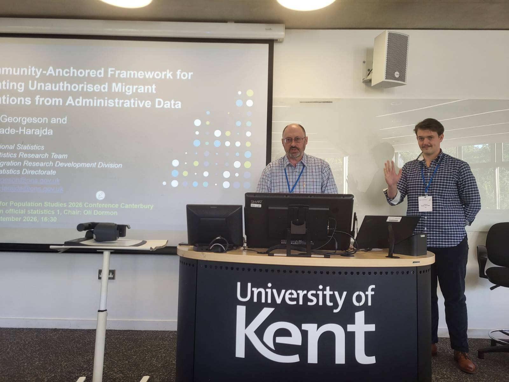
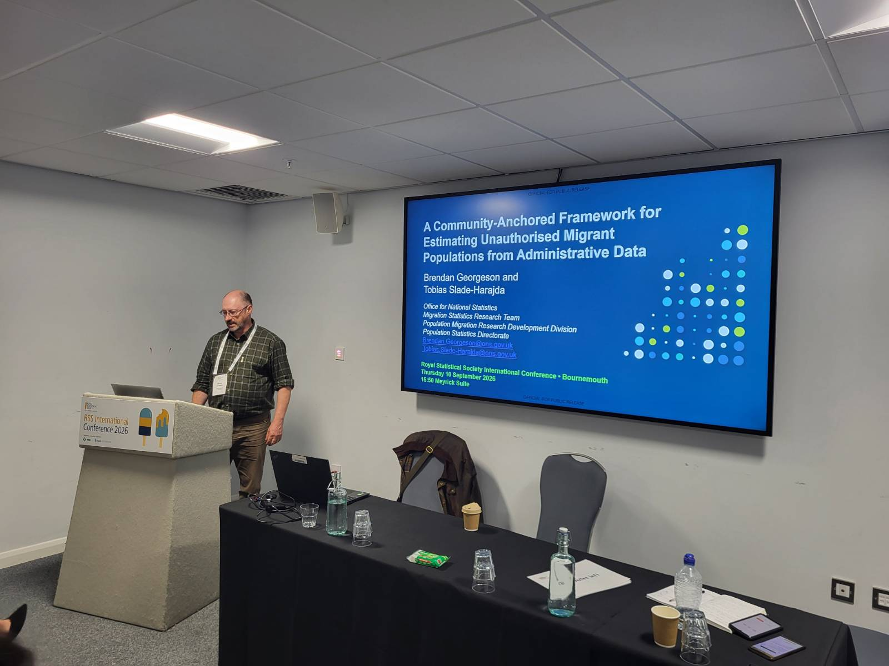

In September 2026, I and Tobias Slade-Harajda presented the UK Office for National Statistics partnership research with Poznan University of Economics and Business research, the Migration Observatory University of Oxford, and the University of Southampton at two of the United Kingdom's leading population and statistics conferences: the **British Society for Population Studies [(BSPS)](https://www.lse.ac.uk/international-development/research/british-society-for-population-studies/annual-conference) Annual Conference**, held at the University of Kent in Canterbury on 8 September, and the **Royal Statistical Society [(RSS)](https://virtual.oxfordabstracts.com/event/76886/program?date=%222026-9-10%22) International Conference** in Bournemouth on 10 September. Both events brought together researchers, official statisticians, policymakers and data scientists to discuss recent advances in population studies, migration research and statistical methodology.

As a Principal Researcher at the UK Office for National Statistics, I presented a paper that I co-authored with Maciej Beręsewicz (lead author), Peter Walsh, Aniela Czerniawska, and Li-Chun Zhang, entitled "Counting Shadows: A Community-Anchored Modeling Framework for Estimating Unauthorized Population Size". The presentation formed part of the Developments in Official Statistics session at BSPS and was subsequently delivered to an international audience at the RSS Conference.

The paper addresses one of the most challenging problems in migration statistics: how to estimate the size of hidden or unauthorised populations when direct observation is impossible and individual-level record linkage is either unavailable or unreliable. We propose a community-anchored modelling framework that uses aggregated administrative data alone to estimate unauthorised populations. Rather than requiring records to be linked across multiple databases, the framework exploits relationships between authorised and unauthorised populations and quantifies uncertainty through analytical and bootstrap-based methods.

Using administrative data from Poland between 2019 and 2024, the model estimates an adult non-Schengen unauthorised population of around 98,000 individuals in 2019 and 108,000 in 2024. The methodology also identifies important structural changes following the implementation of the European Union Temporary Protection Directive in 2022, revealing a substantial decline in the unauthorised Ukrainian population alongside growth in the non-Ukrainian unauthorised population. Importantly, the approach provides a practical framework that can be applied in countries where detailed record linkage is not feasible.

For me, one of the most important aspects of presenting this work was the opportunity to discuss its potential application to the United Kingdom. As migration researchers increasingly seek to make use of administrative data while maintaining privacy and reducing operational complexity, methods that do not rely on linking individual records are becoming particularly valuable. The framework offers a potential basis for future work on estimating hard-to-measure populations in the UK and other countries facing similar evidence gaps.

Both conferences generated valuable discussion and endorsement with researchers from academia, government and national statistical institutes. The feedback received will help inform the further development of the methodology and its potential application to migration statistics and wider population research.

{width="60%" fig-align="center"}

{width="60%" fig-align="center"}
