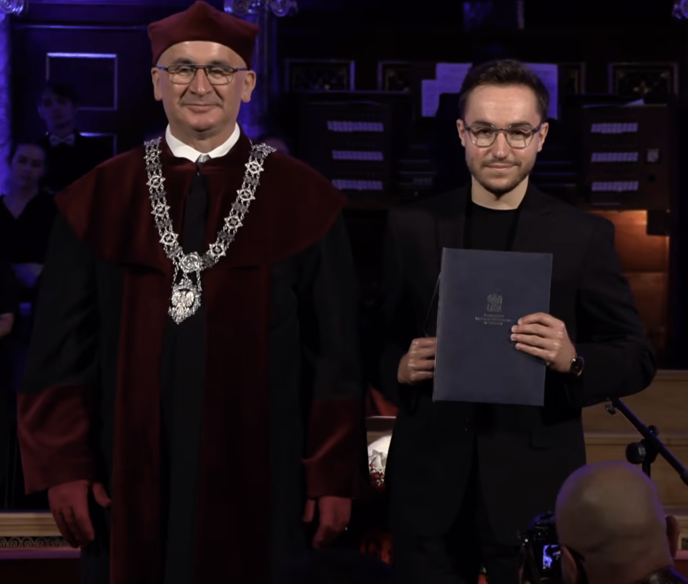
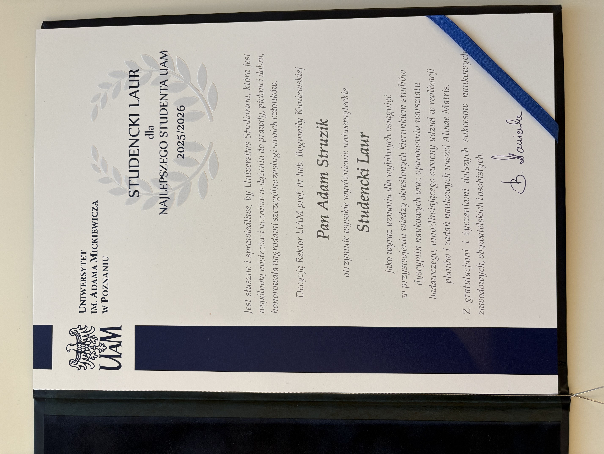
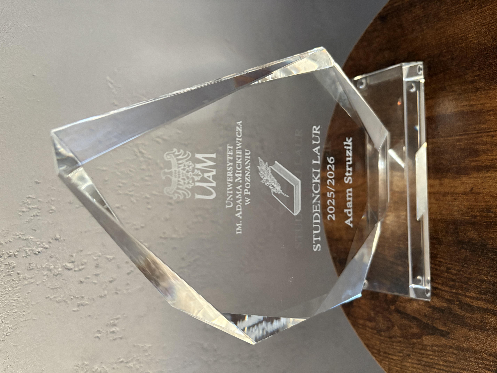

::: {.panel-tabset}

## Polski

1 października 2026 r. odbyła się uroczysta inauguracja roku akademickiego 2026/2027 na Uniwersytecie im. Adama Mickiewicza w Poznaniu. Decyzją Rektor UAM prof. dr hab. Bogumiły Kaniewskiej, Adam Struzik otrzymał wyróżnienie „Studencki Laur”. Nagroda ta jest przyznawana studentom jako wyraz uznania za wysokie wyniki w nauce oraz za aktywność badawczą i osiągnięcia naukowe.

## English

On 1 October 2026, Adam Mickiewicz University (AMU; Poznań, Poland) held its official inauguration of the 2026/2027 academic year. By the decision of the Rector of AMU, Prof. Bogumiła Kaniewska, Adam Struzik was awarded the 'Student Laurel' distinction. The award is granted to students in recognition of their academic excellence, research activities and scientific achievements.

:::

{width="60%" fig-align="center"}

{width="60%" fig-align="center"}

{width="60%" fig-align="center"}
