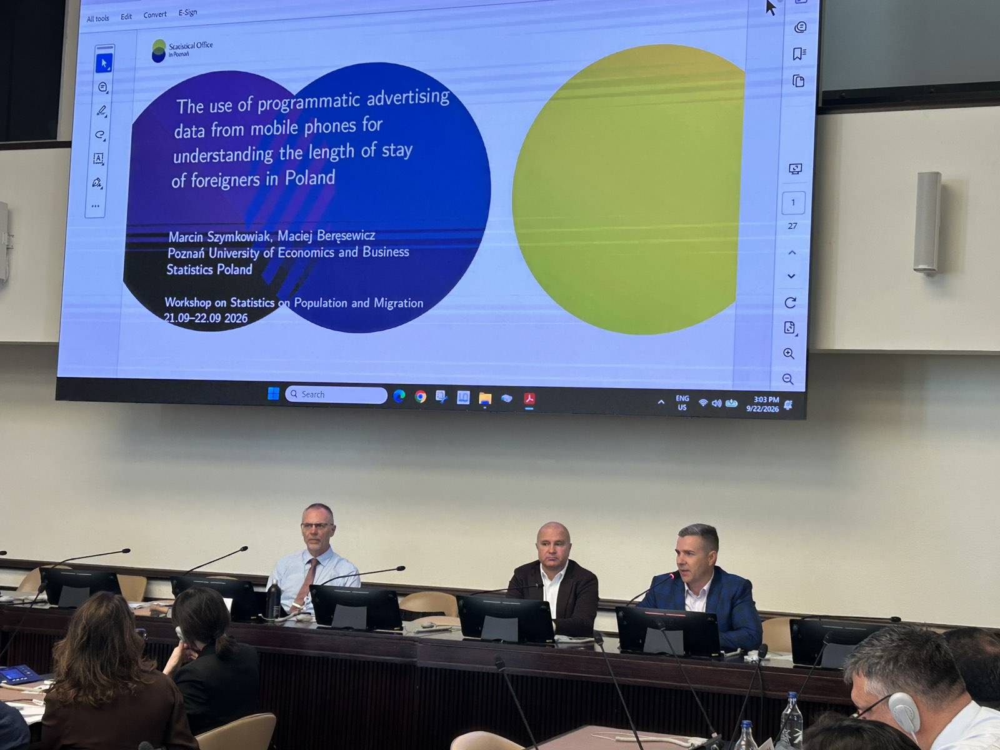
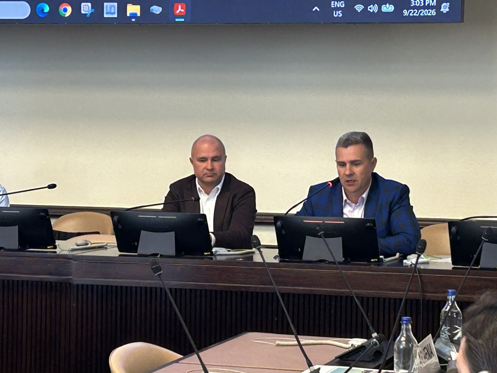

::: {.panel-tabset}

## Polski

Dr hab. Marcin Szymkowiak, prof. UEP z Katedry Statystyki, został zaproszony do wygłoszenia referatu podczas międzynarodowych warsztatów **Workshop on Statistics on Population and Migration**. Odbyły się one w dniach **21-22 września 2026 roku** w siedzibie Organizacji Narodów Zjednoczonych w **Genewie**. Organizatorem była Europejska Komisja Gospodarcza ONZ (UNECE).
 
Warsztaty były platformą wymiany wiedzy i doświadczeń krajowych urzędów statystycznych. Dyskutowano w nich o rozwoju metod i praktycznych wyzwaniach związanych z przejściem od tradycyjnych spisów powszechnych do zintegrowanych systemów danych o ludności. W wydarzeniu uczestniczyli liczni przedstawiciele krajowych urzędów statystycznych, ośrodków akademickich oraz organizacji zajmujących się problematyką migracji.
 
W sesji poświęconej alternatywnym źródłom danych („Alternative Data Sources: Mobile Phone Operators”) dr hab. Marcin Szymkowiak, prof. UEP wygłosił referat **„The Use of Programmatic Advertising Data from Mobile Phones for Understanding the Length of Stay of Foreigners in Poland”**. Przedstawił w nim wyniki badań prowadzonych wspólnie z dr. Maciejem Beręsewiczem, prof. UEP. Analizie poddano dane z ponad 40 milionów smartfonów w Polsce z lat 2018-2021, pozyskane z systemów reklamy programatycznej. Omówiono ich potencjał w statystyce urzędowej, porównanie z rejestrami administracyjnymi i Narodowym Spisem Powszechnym Ludności i Mieszkań 2021 oraz wyniki badania walidacyjnego dokładności klasyfikacji cudzoziemców, w tym długości ich pobytu.
 
Wystąpienie było pokłosiem prac nad raportem **„Measuring new forms of international mobility”**, przygotowanym przez międzynarodowych ekspertów w ramach **UNECE Task Force on Defining and Measuring New Forms of Migration**. W pracach grupy uczestniczyli Marcin Szymkowiak i Maciej Beręsewicz, reprezentujący polską statystykę publiczną. Przygotowali oni jeden z dziewięciu opisanych w raporcie studiów przypadku (Case Study 7), dotyczący wykorzystania danych z reklamy programatycznej na smartfonach do badania długości pobytu cudzoziemców w Polsce.

## English

Marcin Szymkowiak, Associate Professor at the Department of Statistics, Poznań University of Economics and Business (PUEB), was invited to give a talk at the international **Workshop on Statistics on Population and Migration**. The workshop took place on **21–22 September 2026** at the United Nations Office at **Geneva** and was organised by the United Nations Economic Commission for Europe (UNECE).

The workshop served as a platform for national statistical offices to exchange knowledge and experience. Discussions focused on methodological developments and the practical challenges of moving from traditional population censuses to integrated population data systems. The event brought together numerous representatives of national statistical offices, academic institutions and organisations working on migration issues.

In the session on alternative data sources (“Alternative Data Sources: Mobile Phone Operators”), Marcin Szymkowiak presented the paper **“The Use of Programmatic Advertising Data from Mobile Phones for Understanding the Length of Stay of Foreigners in Poland”**. The talk presented the results of research conducted jointly with Maciej Beręsewicz, Associate Professor at PUEB. The study analysed data on more than 40 million smartphones in Poland from 2018–2021, obtained from programmatic advertising systems. The presentation discussed the potential of these data for official statistics, compared them with administrative registers and the 2021 National Population and Housing Census, and reported the results of a validation study on the accuracy of classifying foreigners, including their length of stay.

The talk built on the work on the report **“Measuring new forms of international mobility”**, prepared by international experts within the **UNECE Task Force on Defining and Measuring New Forms of Migration**. Marcin Szymkowiak and Maciej Beręsewicz took part in the work of the Task Force, representing Polish official statistics. They prepared one of the nine case studies described in the report (Case Study 7), which concerns the use of programmatic advertising data from smartphones to study the length of stay of foreigners in Poland.

:::

{width="60%" fig-align="center"}

{width="60%" fig-align="center"}
